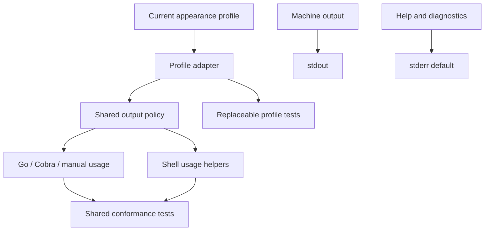

# CLI operator output standard — portable client prompt

**Status:** Reusable working spec for **new TIED clients** (first prompt for `/refine-plan` or `/build-plan`)  
**Proof client:** bkpdir (`[REQ-BKPDIR_CLI_OUTPUT_STANDARD]`, `pkg/clioutput`) — lessons in §12  
**Methodology reference (read-only):** stdd `[REQ-TIED_CLI_OPERATOR_OUTPUT_TEXTURE]` / Bash `how()` — do **not** clone stdd tokens into a client without LEAP migration policy  
**Audience:** Sponsors and agents implementing operator-facing CLI help and diagnostics

---

## 0. How to use this document (first prompt)

Paste or link this file as the **linked plan input** (or the body of the first message) when starting CLI output standard work on a **new** TIED client. Recommended flow:

1. **`/refine-plan`** — RESOLVE client name, primary binary, fleet inventory (Cobra vs manual `usage()` vs shell), costly choices (stderr-default help), adversarial `depth_tier`, and local REQ/ARCH/IMPL token names.
2. **`/build-plan`** — Author one TIED chain, pass `pre_implementation` gate, TDD shared module, wire primary binary, adopt fleet, close-out gates.

**Agent preamble:** Observing AI principles! PRELOAD client CLI vocabulary (`tied-project/vocab/*cli*.md`) before reading source.

**Non-goals for every client (unless explicitly in scope):** methodology promotion into `tied-bundle/`; shared Node `cli-output-policy.mjs`; tokenizing individual colors/flags in TIED; inventing help for binaries that have none.

---

## 1. Purpose — contract vs profile

**Operator output** covers two separable concerns:

| Concern | Track in TIED? | What changes over time |
| --- | --- | --- |
| **Operator output standard** (stream contract) | **Yes** — one REQ/ARCH/IMPL chain | Help/diagnostic routing, parity across entry points, conformance evidence |
| **Appearance profile** (decoration, layout, prose) | **No** — one replaceable adapter + profile tests | ANSI, symbols, rule width, help copy, client-specific env aliases |

**Validation split:**

- **Contract suite** — streams, exit codes, help destination, stdin non-consumption; **must not** assert ANSI or exact help prose.
- **Profile suite** — current decoration and control mapping; rerun contract suite unchanged after profile-only edits.



**Terminology:** Pipelines use **stdout vs stderr**. **stdin** is command input only — help and errors must not be written to stdin.

---

## 2. Stream contract (portable)

| Channel | Role | Default |
| --- | --- | --- |
| **stdout** | Successful **machine** output (JSON, paths, IDs, matrix lines where defined as machine) | Data plane |
| **stderr** | **Human help** (default) and **all diagnostics** | Operator plane |
| **stdin** | Interactive or piped command input | Never help/errors |

Rules:

1. **Successful help (default):** help on **stderr**; **stdout empty**.
2. **Successful help (explicit stdout override):** help on **stdout**; **stderr empty** on success (failures still use stderr).
3. **Failure:** messages on **stderr**; **stdout empty** unless a subcommand defines machine error JSON on stdout.
4. **Normal commands:** machine output stays on **stdout** regardless of help policy.
5. **`2>&1`** is an operator choice; it does not change internal routing.

### Why stderr-default help

```bash
mycli list … | jq .
other-tool | mycli backup …
```

If help defaults to stdout, a mistyped flag pollutes the pipe. stderr-default keeps stdout for intentional data.

---

## 3. Controls and migration

| Control | Effect |
| --- | --- |
| *(default)* | Help on stderr; stdout empty on success |
| `--stdout` | Help on stdout; stderr empty on success |
| `TIED_CLI_HELP_STDOUT=1` | Same as `--stdout` |

**Plain triggers (any one forces plain):** `--plain`, `-p`, `--no-color`, `TIED_CLI_PLAIN=1`, non-empty `NO_COLOR`, non-TTY **selected help writer**.

**Cross-client env names (recommended):** `TIED_CLI_PLAIN`, `TIED_CLI_HELP_STDOUT`. Client-specific prefixes only with documented precedence.

**Costly choice — document in release notes:** moving default help from stdout to stderr breaks `mycli --help | …` unless operators use `2>&1` or explicit stdout help.

**Peel order:** parse/remove global texture flags **before** subcommand dispatch and **before** any alternate argv router (path auto-detect, topic dispatch).

---

## 4. Appearance profile (reference defaults)

When texture is on and the help writer is a TTY (stdd / bkpdir working profile):

| Element | Treatment |
| --- | --- |
| Title | Bold |
| Section header | Bold + cyan + optional `▶` |
| Section rule | Dim, 56× `─` |
| Command row | Bold name; ~26-column pad; dim description |
| Notes | Dim body |

Plain mode: no ANSI, 56 ASCII hyphens, no `▶`, fixed columns.

Palette reference: stdd [`console.mjs`](https://github.com/fareed/stdd/blob/main/tools/bootstrap/lib/console.mjs). Profile-only changes stay behind one renderer/adapter seam.

---

## 5. Errors and exit codes (reference)

| Condition | stdout | stderr | Exit |
| --- | --- | --- | --- |
| Success, default help | empty | help | 0 |
| Success, `--stdout` help | help | empty | 0 |
| Unknown flag / usage error | empty | message | non-zero |
| Normal machine command | data | diagnostics only | 0 |

---

## 6. TIED representation (generic pattern)

Create **one** feature chain named for the **standard**, not today’s decoration:

| Layer | Name pattern | Scope |
| --- | --- | --- |
| REQ | `[REQ-{CLIENT}_CLI_OUTPUT_STANDARD]` | Streams, help selection, diagnostic isolation, entry-path parity, fleet conformance |
| ARCH | `[ARCH-{CLIENT}_CLI_OUTPUT_STANDARD]` | Policy/profile boundary, framework adapters (Cobra, manual, shell), peel seam |
| IMPL | `[IMPL-{CLIENT}_CLI_OUTPUT_CONFORMANCE]` | Module seams, profile versioning, contract vs profile tests, adoption evidence |

**Do not create REQ/ARCH/IMPL for:** `--plain`, `--stdout`, individual env vars, ANSI, symbols, rule width, help paragraphs.

**Cross-reference only** existing CLI/usability/auto-detect/output tokens — do not redefine immutable contracts.

**Working folder (per client):** `tied-project/working/REQ-{CLIENT}_CLI_OUTPUT_STANDARD/` — Tracker copy, CITDP, test-strategy, gate receipts.

**Adversarial depth (typical):** `minimal` + `advisory` for local stream routing only; record counterexamples/falsification questions in CITDP; mark `sub-adversarial-inquiry-pass` N/A at minimal depth when gate requires it.

**Gate:** `tied_checklist_gate_validate` with `phase: pre_implementation` before RED tests.

---

## 7. Generic implementation plan (build-plan phases)

### Phase A — Shared module

Introduce a small library (e.g. `pkg/clioutput` or `{module}/clioutput`) with:

| Seam | Responsibility |
| --- | --- |
| **Policy resolver** | Help destination, plain mode, TTY on selected writer; pure + unit-tested |
| **Peel** | Remove global texture flags from argv before Cobra or custom routers |
| **Profile adapter** | Current flags/env/precedence; single replaceable unit |
| **Renderer** | Optional; profile tests own ANSI/layout |
| **Framework adapter** | Cobra: `ApplyToRoot`, persistent flags, custom `HelpFunc`; manual: shared policy for `usage()` |
| **Execute helper** | Peel → resolve → apply → `Execute` (optional `ExecuteRoot`) |
| **Conformance harness** | Table cases for subprocess + shell |

**TDD order:** policy RED → peel RED → framework adapter RED → composition RED → subprocess contract per adopted binary.

Do not refactor unrelated formatters/collectors unless contract evidence proves stdout pollution.

### Phase B — Primary binary

- Register subcommands/flags first, then apply policy.
- **Dual paths:** any bypass of the CLI framework (auto-detect, path-first argv) must use the **same** peeled argv and policy as Cobra.
- Top-level execution errors → **stderr** (not stdout).
- Composition tests: **separate** stdout/stderr buffers; subprocess tests where code writes directly to `os.Stdout`/`os.Stderr`.

### Phase C — Fleet adoption

Inventory **actual** help surfaces; skip tools with no in-binary help.

| Class | Action |
| --- | --- |
| Cobra binaries | `ApplyToRoot` / `ExecuteRoot` |
| Manual `usage()` already on stderr | Align flags/env; preserve machine stdout lines |
| Separate Go modules | `replace` or extract shared module — do not fork policy |
| Makefile-only help | Out of scope |

One lightweight subprocess contract test per adopted binary.

### Phase D — Shell

One sourced include (e.g. `scripts/_cli_operator_output_standard.inc.sh`) for stream selection, plain fallback, usage emission. Migrate scripts that already have `usage()` / `--help`; compare against the same conformance matrix as Go.

### Phase E — Close-out

Profile + contract suites green; client CLI vocabulary updated; `pseudocode_validate`; `tied_validate_consistency`; verification and close_out gates; envelope sync per client checklist.

---

## 8. Acceptance matrix (contract)

1. Default help: exit success, **empty stdout**, help on **stderr**.
2. Explicit stdout help: help on **stdout**, success **stderr empty**.
3. Usage/unknown flag: **empty stdout**, diagnostic on **stderr**, non-zero exit.
4. Normal machine output on stdout; diagnostics on stderr.
5. All entry paths (framework + custom router) resolve the **same** policy.
6. Help does not consume piped stdin.
7. Every **adopted** binary/script passes the same cases.

Profile suite separately verifies §4 decoration.

**Future profile change:** CITDP classifies profile-only vs contract-changing → update adapter/renderer + profile tests → rerun contract suite. Contract change → LEAP `IMPL → ARCH → REQ`.

---

## 9. First-prompt checklist (copy for refine-plan)

- [ ] Client id `{CLIENT}` and primary CLI binary name
- [ ] Fleet table: Cobra / manual usage / shell / skip
- [ ] Existing shorthand collisions (e.g. `-n` used twice) — peel texture before custom parsers
- [ ] Costly choices acknowledged (stderr-default help)
- [ ] Local REQ/ARCH/IMPL token names recorded
- [ ] `depth_tier` and gate policy in CITDP
- [ ] Test strategy: contract vs profile split
- [ ] Non-goals confirmed (no per-flag TIED tokens, no new help surfaces)

---

## 10. stdd methodology reference (read-only)

| Artifact | Location (stdd repo) |
| --- | --- |
| REQ | `tied-project/requirements/REQ-TIED_CLI_OPERATOR_OUTPUT_TEXTURE.yaml` |
| ARCH | `tied-project/architecture-decisions/ARCH-TIED_CLI_OPERATOR_OUTPUT_TEXTURE.yaml` |
| IMPL | `tied-project/implementation-decisions/IMPL-TIED_BUILD_COMMANDS_HOW_TEXTURE.yaml` |
| Bash `how()` | `scripts/_build_commands_cli_guide.inc.sh` |
| Tests | `tools/bootstrap/build-commands-how.test.mjs` |

Bash init order: peel globals → topic → stream init → plain init (TTY on help fd) → render.

---

## 11. Operator recipes

| Intent | Pattern |
| --- | --- |
| Machine output only | Run subcommand; avoid bare root help mid-pipe |
| Help without touching stdout | `mycli --help` (stderr-default) |
| Legacy capture to file | `TIED_CLI_HELP_STDOUT=1 mycli --help > help.txt` |
| CI plain | `NO_COLOR=1` or `TIED_CLI_PLAIN=1` |
| Merge for logging | `mycli … 2>&1 \| tee log.txt` |

---

## 12. Lessons from bkpdir proof implementation (2026-10)

These are **implementation** lessons, not new requirements. Use them to avoid repeat failures on the next client.

### TIED and process

- **One chain, minimal churn:** Keeping decoration out of TIED let profile tweaks stay in code/tests; only stream semantics belong in REQ satisfaction criteria.
- **refine-plan before build-plan:** Fleet inventory, costly choices, and gate blockers documented in `tied-project/working/REQ-…/` saved rework.
- **pre_implementation gate:** Author REQ/ARCH/IMPL + `pseudocode_validate` + Tracker dispositions (including `sub-adversarial-inquiry-pass` N/A at minimal depth) before RED tests.

### Cobra / Go

- **Do not reimplement Cobra help templates** for the default case. Save each command’s default `HelpFunc`, then delegate with **`SetOut(helpWriter)`** for the duration of the call (`OutOrStdout()` to restore). Re-parsing templates without Cobra’s full `FuncMap` breaks help (e.g. `trimTrailingWhitespaces` arity errors).
- **`ApplyToRoot` must use injectable writers** in tests: call `SetOut`/`SetErr` with `policy.DataWriter()` / `policy.DiagWriter()`, not hard-coded `os.Stdout`/`os.Stderr`, or composition tests lie.
- **Peel texture argv in `main` before** auto-detect or custom routers; extend peel lists on any secondary parser so `-p` / `--stdout` never reach the wrong consumer.
- **Execution errors:** route `Execute` failures to stderr (`PrintExecError`), not `fmt.Println` on stdout.
- **Subprocess contract tests** catch real `os.Stdout`/`os.Stderr` behavior that in-process Cobra buffers miss (formatters, delayed flush).
- **TTY helper:** small `golang.org/x/term` (or equivalent) dependency for “plain when help fd is not a TTY”; pin versions compatible with the client’s Go toolchain.

### Dual entry paths

- If the root command both **Cobra** and **path auto-detect** (or similar) exist, both must see **peeled argv** and the same resolved policy. Composition tests should assert help on stderr for subcommands **and** document auto-detect separately.

### Shorthand collisions

- Do **not** repurpose an existing short flag (bkpdir: root `-n` = list limit vs auto-detect `-n` = note). Add texture globals only with peel-before-router discipline; do not “fix” legacy semantics in the same REQ.

### Fleet and shell

- **Adopt Cobra satellites** via a single `ExecuteRoot(root, os.Args[1:])` — no copy-pasted help logic per `cmd/`.
- **Separate Go modules** (`cmd/foo` with its own `go.mod`) need an explicit module strategy before adoption.
- **Manual tools** (e.g. specctl-style): usage already on stderr is a good baseline; do not move machine matrix/report lines off stdout.
- **Shell:** a shared include is enough to start; migrating every script is a second wave — contract matrix still applies per migrated script.

### Tests

- Split **contract** (empty stdout on default `--help`) from **profile** (no `\x1b[` when plain).
- Update composition tests that merged stdout+stderr — they will fail intentionally when stderr-default help lands.

### Vocabulary

- Replace “Help coverage: N/A” with standard terms, profile link, and stderr migration note in the client CLI glossary.

### Proof artifacts (bkpdir)

| Artifact | Path |
| --- | --- |
| Module | `pkg/clioutput/` |
| TIED | `REQ-BKPDIR_CLI_OUTPUT_STANDARD`, `ARCH-BKPDIR_CLI_OUTPUT_STANDARD`, `IMPL-BKPDIR_CLI_OUTPUT_CONFORMANCE` |
| Subprocess tests | `cli_output_contract_test.go` |
| Shell include (starter) | `scripts/_cli_operator_output_standard.inc.sh` |
| Working request | `tied-project/working/REQ-BKPDIR_CLI_OUTPUT_STANDARD/` |

---

## 13. Document history

| Date | Change |
| --- | --- |
| 2026-10-22 | Initial spec from stdd texture REQ and bkpdir seam review |
| 2026-10-22 | Generic portable prompt: plan phases, TIED pattern, bkpdir lessons; status updated after proof implementation |
